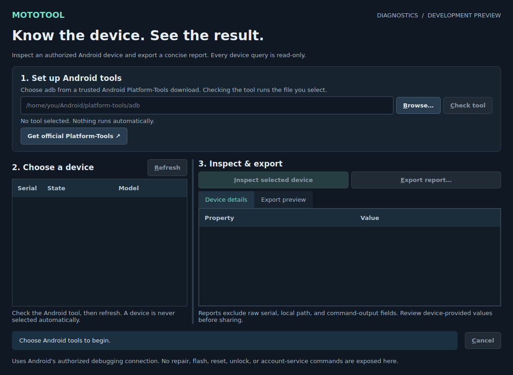

# MotoTool

### Know the device. See the result.

A Qt/C++ desktop workbench for clearer Motorola and Android diagnostics, with a
professional development foundation for future, validated service operations.

**Development preview · `0.1.0-dev` · Windows-first · Qt 5 / Qt 6**

[Getting started](#getting-started) · [Build guide](docs/DEVELOPMENT.md) ·
[Roadmap](docs/ROADMAP.md) · [Architecture](docs/ARCHITECTURE.md) ·
[Engineering audit](docs/AUDIT.md)



## What this version does

`MotoTool_Diagnostics` is the new default application. It provides a focused
workflow: choose your Android tools, select a connected device, inspect it, and
review a report before exporting.

| Capability | Behavior |
| --- | --- |
| Guided tool setup | Select an explicit local ADB executable; see its version and SHA-256 fingerprint |
| Device discovery | See connected devices and their authorization/connection state |
| Explicit targeting | Select the intended device; inspection checks its identity and binds commands to it |
| Read-only inspection | Read manufacturer, model, Android version, build ID, and security-patch date |
| Clear execution state | Bounded requests, cancellation, and distinct success/error outcomes |
| Controlled reporting | Preview/export JSON with a session device pseudonym; omit raw serial/path/transcript fields |
| Usable workspace | Resizable desktop layout, keyboard-accessible controls, and connection guidance |

Tool checks run the executable you select. Obtain it from the official Android
Platform-Tools distribution; a displayed fingerprint identifies a file but does
not authenticate its publisher. ADB may start or reuse its local server.

This is a development build. Physical-device compatibility and an installable
Windows release are still being validated. There is no published production
installer or universal Motorola/MediaTek support claim.

## Getting started

1. **Build the diagnostics application** using the [development guide](docs/DEVELOPMENT.md).
2. **Get Android Platform-Tools** from [Google's official download](https://developer.android.com/tools/releases/platform-tools)
   or Android Studio's SDK Manager.
3. **Open MotoTool Diagnostics**, browse to the native `adb.exe` on Windows or
   `adb` on Linux, and choose **Check tool**.
4. Connect a device with USB debugging enabled and approve its debugging prompt.
   Choose **Refresh**, then select the intended device.
5. Choose **Inspect selected device**. Review **Device details** and **Export preview**;
   use **Export report** when you want a JSON file.

No account-service login is needed by the diagnostics application. Inspection
uses a restricted set of read-only commands. The original service workflows are
kept in a separate legacy application.

### Quick build

With Qt development libraries, CMake, Ninja, a C++17 compiler, and Python installed:

```sh
cmake --preset linux-debug
cmake --build --preset linux-debug
ctest --preset linux-debug
```

Use `linux-qt6` for the Qt 6 configuration. On Windows with a compatible Qt MSVC
kit and Visual Studio 2022:

```powershell
cmake --preset windows-msvc -DCMAKE_PREFIX_PATH=C:/Qt/5.15.2/msvc2019_64
cmake --build --preset windows-msvc
ctest --preset windows-msvc
```

Replace the example Qt path with your installation. The [full guide](docs/DEVELOPMENT.md)
explains dependencies, output locations, runtime requirements, tests, and the
optional legacy build.

## Professional development foundation

The repository now separates UI, diagnostic execution, and legacy servicing.
CMake presets and CTest provide repeatable local builds. GitHub Actions defines
Linux Qt 5, Linux Qt 6, and native Windows Qt 5 checks. Deterministic fake-tool
fixtures exercise behavior without phones or external accounts.

Contributions follow a small-branch, reviewable-PR workflow with explicit
acceptance criteria and recorded validation. CI logs, detailed findings, and
remaining gates belong in the [audit](docs/AUDIT.md),
[contributor guide](CONTRIBUTING.md), and
[device acceptance matrix](docs/DEVICE_TEST_MATRIX.md).

## About the legacy client

The original `MotoTool_MTK` Qt 5 application, identifying itself as `0.0.3`, is
preserved for engineering review. It is excluded from the default CMake build;
use `-DMOTOTOOL_BUILD_LEGACY=ON` with Qt 5 to compile it explicitly. The original
qmake project is also retained.

Earlier credential, log-upload, charge-response, serial-selection, and FRP
containment work is preserved. The remaining legacy execution, protocol,
account, and device-safety defects are documented in the [audit](docs/AUDIT.md).
A compiled legacy executable is not a supported servicing release.

## Project documentation

| Document | Purpose |
| --- | --- |
| [Development guide](docs/DEVELOPMENT.md) | Toolchain, build/test commands, and daily workflow |
| [Architecture](docs/ARCHITECTURE.md) | Runtime boundaries and extension design |
| [Roadmap](docs/ROADMAP.md) | Ordered product work and acceptance criteria |
| [Engineering audit](docs/AUDIT.md) | Findings, evidence, inherited fixes, and remaining work |
| [Device test matrix](docs/DEVICE_TEST_MATRIX.md) | Real device and Windows acceptance requirements |
| [Contributing](CONTRIBUTING.md) | Review and contribution conventions |
| [Security policy](SECURITY.md) | Project status and vulnerability reporting |
| [Third-party notices](THIRD_PARTY_NOTICES.md) | Attribution, dependencies, and distribution rights |

## Credits and licensing status

The inherited project history includes **Mubashir Iqbal**
([Mubshr07](https://github.com/Mubshr07)) and earlier contributors. This repository
preserves that history and credits; the modernization does not claim original
authorship of their work.

A repository-wide license for the inherited source/assets has not been
established. No new blanket license is applied. See
[THIRD_PARTY_NOTICES.md](THIRD_PARTY_NOTICES.md) for the evidence and the rights
that need to be resolved before distribution.
