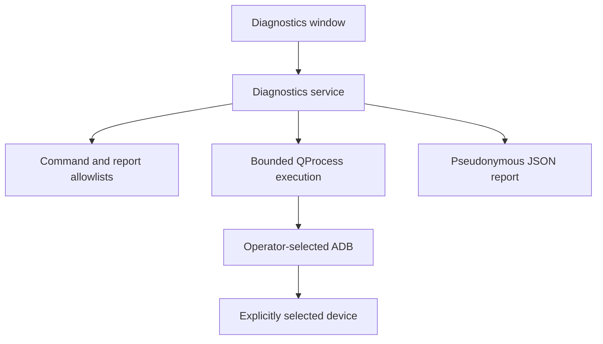
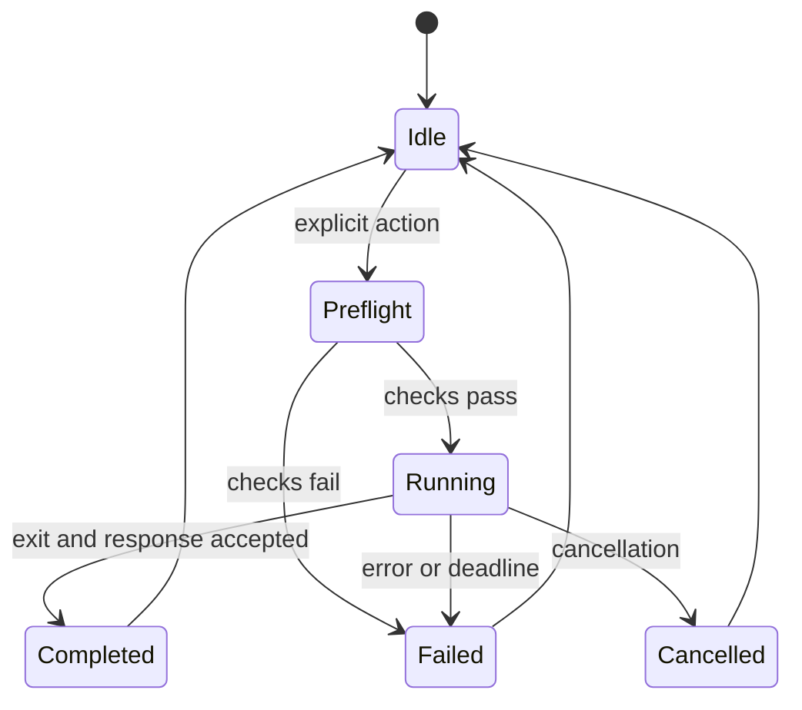

# Architecture

## Direction

`MotoTool_Diagnostics` is the default application for new development. Its first
capability is a guided read-only ADB inspection. The inherited `MotoTool_MTK`
application remains a separate, optional engineering target.

The two applications do not share a live account session, command dispatcher,
device-operation globals, or remote service client. This is a deliberate boundary:
improvements to diagnostics must not accidentally enable an old servicing path.

## Runtime boundaries

The UI owns presentation and explicit operator actions. The service owns execution
state, argument construction, subprocess completion, discovery parsing, and report
construction. UI widgets must not create shell command strings or decide that a
device operation succeeded from a progress-bar value.

The service uses Qt Core; the desktop uses Qt Widgets. The new runtime does not
depend on the legacy network/account, serial, META, or billing implementations.

### Tool boundary

The operator selects a local `adb` executable from an independently obtained
Platform-Tools installation. Resolve its canonical absolute path, inspect the
file, record SHA-256, and check its version output. Invoke it directly with a
separate argument list. Do not search `PATH`, invoke a host shell, launch a batch
wrapper, or request elevation as part of diagnostics.

**A computed hash identifies a file; it does not establish that Google published
it.** The version string is also supplied by that executable. Publisher authenticity
requires trusted acquisition and, where available, independent expected hashes or
signature verification. Rechecking the selected file detects ordinary changes; it
is not a complete defense against a hostile local process replacing files between
validation and execution.

ADB itself runs a local server and communicates with connected devices. Ending a
diagnostic subprocess does not mean the shared ADB server was terminated. The
application must not automatically kill that server, reset unrelated sessions,
or change system drivers to recover from an error.

The service addresses the local ADB server explicitly. That server can already
have USB, TCP, or wireless device transports; loopback server selection is not a
USB-only guarantee. Disabling automatic mDNS connection for a client process does
not undo connections already owned by the shared server.

### Device boundary

Discovery records the serial and state reported by ADB. Showing a device in a
list is not authorization to run an operation. The operator chooses a device;
inspection refreshes the snapshot and binds every device command to that serial.
An offline, unauthorized, missing, duplicated, or otherwise unsupported target
does not silently fall back to another device.

Serial numbers are a transport identifier, not cryptographic proof of physical
identity. A future write workflow needs a stronger per-device context, explicit
profile validation, and a consistent reconnect policy. Device-reported model and
build strings are informational until matched against independently validated
capability records.

### Execution boundary

The initial service accepts fixed operation types instead of arbitrary commands:
tool inspection, device discovery, and a restricted set of read-only properties.
Its API is not a general shell console.

Each accepted operation has one owner and one terminal result. Another operation
cannot start while the current service operation is active. Timeouts cover both
individual subprocesses and the complete multi-command inspection; output has a
defined bound. Process errors, abnormal exits, malformed responses, cancellation,
and deadlines must produce distinct failure information, not success.

An operation should follow this conceptual sequence:

These are architectural states, not a promise that the implementation exposes
these exact enum names. A cancelled request is not a completed inspection. For
future operations that write to devices, stopping the local process must never
be described as rolling back the device.

### Report boundary

Exports are constructed from a defined JSON schema, not a transcript of console
output. The initial schema contains selected diagnostic properties, application
and tool metadata, and a session-scoped device pseudonym. Raw serial fields,
local filesystem paths, account details, raw stdout/stderr, and legacy logs are
excluded by design.

Pseudonymization is not guaranteed anonymity: model/build metadata and free-form
device responses can still be sensitive. Exports must remain bounded, allowlisted,
and reviewable before sharing. A privacy review should assess each new property
rather than assuming a read-only command produces harmless data.

## Legacy boundary

Legacy sources are compiled only when explicitly requested through the optional
CMake target or the retained qmake project. The old login, service contracts,
helper data, and device-changing operations are not made part of diagnostics
merely by compiling that target.

The old `GlobalVars`, repeated workers, synchronous network patterns, and permissive
output parsing must not become dependencies of the new service. Reuse small pure
helpers only after reviewing their behavior and tests. See [AUDIT.md](AUDIT.md)
for current defects and [HARDENING.md](HARDENING.md) for the prior increment.

## Future extension points

| Boundary | Planned responsibility | Acceptance condition |
| --- | --- | --- |
| Device profile registry | Model/build capabilities and tools | Evidence-backed records, explicit unknown state |
| Operation plan | Target, steps, effects, prerequisites, verification | Inspectable before execution; immutable once started |
| Operation coordinator | Per-device ownership and queued work | No competing jobs; tested reconnect handling |
| Tool registry | Versions, provenance, acquisition, expected identity | Reviewed sources and distribution rights |
| Optional service adapter | Typed requests and account transactions | Bounded requests, schemas, cancellation, reconciliation |
| Operation journal | Useful outcomes and recoverable state | Redaction, bounded retention, explicit export |
| Release manifest | Revision, dependencies, hashes, validation | Evidence for the distributed artifact |

Implement these boundaries when a feature needs them. A plugin framework, cloud
backend, microservices, or installer service is not required for diagnostics.

## Design references

- [Qt QProcess](https://doc.qt.io/qt-6/qprocess.html)
- [Android ADB device targeting](https://developer.android.com/tools/adb)
- [Official Platform-Tools installation](https://developer.android.com/tools/releases/platform-tools)
